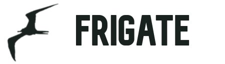

<p align="center">
  
</p>

# Frigate NVR™ - Realtime Object Detection for IP Cameras

[](https://opensource.org/licenses/MIT)

<a href="https://hosted.weblate.org/engage/frigate-nvr/">

</a>

\[English\] | [简体中文](https://github.com/blakeblackshear/frigate/blob/dev/README_CN.md)

A complete and local NVR designed for [Home Assistant](https://www.home-assistant.io) with AI object detection. Uses OpenCV and Tensorflow to perform realtime object detection locally for IP cameras.

Use of a GPU or AI accelerator is highly recommended. AI accelerators will outperform even the best CPUs with very little overhead. See Frigate's supported [object detectors](https://docs.frigate.video/configuration/object_detectors/).

- Tight integration with Home Assistant via a [custom component](https://github.com/blakeblackshear/frigate-hass-integration)
- Designed to minimize resource use and maximize performance by only looking for objects when and where it is necessary
- Leverages multiprocessing heavily with an emphasis on realtime over processing every frame
- Uses a very low overhead motion detection to determine where to run object detection
- Object detection with TensorFlow runs in separate processes for maximum FPS
- Communicates over MQTT for easy integration into other systems
- Records video with retention settings based on detected objects
- 24/7 recording
- Re-streaming via RTSP to reduce the number of connections to your camera
- WebRTC & MSE support for low-latency live view

## Documentation

View the documentation at https://docs.frigate.video

## Local build and verification

### Build the Docker image

Install Docker with Buildx and GNU Make. On macOS, start Docker Desktop first. Run these commands from the repository root:

```bash
docker info
make local
docker image inspect frigate:latest --format 'ID={{.Id}} Size={{.Size}}'
```

`make local` builds and loads `frigate:latest` for the Docker engine's architecture, including the Python backend and production web frontend. It generates ignored build metadata in `frigate/version.py` and `web/.env`; it does not start the application.

If Docker is unavailable, start the engine before building. If the build fails during image export with an `EOF` or connection error, check the engine's status. On Docker Desktop, restart it with `docker desktop restart`, confirm `docker info` succeeds, then retry `make local`.

### Run an isolated smoke test

Use the same terminal for setup and cleanup so that `FRIGATE_VERIFY_DIR` remains available. Create a temporary configuration without modifying the project's `config/` directory:

```bash
FRIGATE_VERIFY_DIR=$(mktemp -d /tmp/frigate-verify.XXXXXX)
cat > "$FRIGATE_VERIFY_DIR/config.yml" <<'YAML'
mqtt:
  enabled: false
auth:
  enabled: false
tls:
  enabled: false
cameras: {}
YAML

docker run -d \
  --name frigate-verify \
  --shm-size=256m \
  -p 127.0.0.1:8971:8971 \
  --mount "type=bind,source=$FRIGATE_VERIFY_DIR,target=/config" \
  --mount type=tmpfs,destination=/tmp/cache,tmpfs-size=536870912 \
  frigate:latest
```

Authentication and TLS are disabled only for this local smoke test. Keep the port bound to `127.0.0.1`; do not use this configuration for deployment. Port 5000 is not published, avoiding conflicts with services such as macOS AirPlay Receiver.

Check startup logs and repeat the status command until health is `healthy`. If the container exits or becomes unhealthy, inspect its logs before proceeding:

```bash
docker logs --tail 100 frigate-verify
docker inspect frigate-verify \
  --format 'Status={{.State.Status}} Health={{.State.Health.Status}} Restarts={{.RestartCount}}'
```

Expect `Status=running Health=healthy Restarts=0`. Verify that the web UI and API endpoints return HTTP 200:

```bash
curl --fail --silent --show-error -o /dev/null \
  -w 'Web UI HTTP %{http_code}\n' http://127.0.0.1:8971/
curl --fail --silent --show-error http://127.0.0.1:8971/api/
curl --fail --silent --show-error http://127.0.0.1:8971/api/version
curl --fail --silent --show-error http://127.0.0.1:8971/api/stats
```

The health endpoint should report `Frigate is running. Alive and healthy!`, the version should match the build, and stats should contain an empty `cameras` object. Open http://127.0.0.1:8971 to check UI rendering and confirm JavaScript and CSS requests succeed in the browser's network panel.

This smoke test verifies startup and HTTP serving, not camera streaming, object detection, MQTT integration, or recording. A CPU detector warning is expected with the default test configuration.

### Clean up

Stop and remove the test container before deleting its temporary configuration and database:

```bash
docker stop frigate-verify && docker rm frigate-verify
```

After the container has been removed, delete the temporary directory:

```bash
case "${FRIGATE_VERIFY_DIR:-}" in
  /tmp/frigate-verify.*)
    rm -r -- "${FRIGATE_VERIFY_DIR:?}"
    unset FRIGATE_VERIFY_DIR
    ;;
esac
```

The `frigate:latest` image remains available for future use.

## Donations

If you would like to make a donation to support development, please use [Github Sponsors](https://github.com/sponsors/blakeblackshear).

## License

This project is licensed under the **MIT License**.

- **Code:** The source code, configuration files, and documentation in this repository are available under the [MIT License](LICENSE). You are free to use, modify, and distribute the code as long as you include the original copyright notice.
- **Trademarks:** The "Frigate" name, the "Frigate NVR" brand, and the Frigate logo are **trademarks of Frigate, Inc.** and are **not** covered by the MIT License.

Please see our [Trademark Policy](TRADEMARK.md) for details on acceptable use of our brand assets.

## Screenshots

### Live dashboard

<div>

</div>

### Streamlined review workflow

<div>

</div>

### Multi-camera scrubbing

<div>

</div>

### Built-in mask and zone editor

<div>

</div>

## Translations

We use [Weblate](https://hosted.weblate.org/projects/frigate-nvr/) to support language translations. Contributions are always welcome.

<a href="https://hosted.weblate.org/engage/frigate-nvr/">

</a>

---

**Copyright © 2026 Frigate, Inc.**
